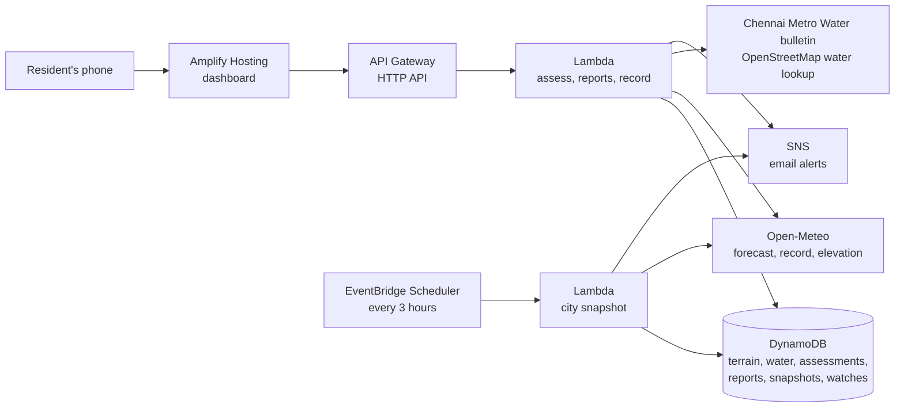

# Vellam

Vellam is the Tamil word for flood. It tells a resident of India whether their own street is
likely to flood in the next 48 hours, why, and what to do about it. Then it checks its own
forecast against the rain that fell. It began with Chennai, which still has the deepest
record, and now answers for any place in the country.

**Live:** https://vellam.d3tsllqujf4lwr.amplifyapp.com

Built for [Environmental Hacks](https://www.wemakedevs.org/aws/env), event two of the
WeMakeDevs x AWS Bharat Builds Tour, 8 to 11 October 2026. Track: **Heat and Water**. Path:
**Ship It**, deployed on AWS.

## 1. The problem

Flood warnings in India are issued for a district. Floods happen street by street.

In December 2015 and again in December 2023, large parts of Chennai went under water, and
many of the same neighbourhoods were hit both times. A resident reading "heavy rain likely
over Chennai district" still does not know the thing they need: will my street flood, when,
and should I move the bike tonight?

The northeast monsoon, which brings Chennai most of its rain, starts in October. The same gap
between a district warning and a street exists in every Indian city that floods.

## 2. What Vellam does

| For a resident | How |
|---|---|
| **Will my street flood?** | Search any city, town or village in India, use your location, or tap any spot on the map. One of four levels, LOW, WATCH, HIGH or SEVERE, for each six hours of the next 48 |
| **Why?** | Every fact behind the answer, each marked as a forecast, a measurement, terrain, a map, the 2015 record, a reservoir bulletin, a neighbour's report, or Vellam's own judgement |
| **What should I do?** | Steps for that level, helplines as tap-to-call buttons, and one tap to send the warning to a street WhatsApp group |
| **What does my street look like?** | The street in 3D with real ground heights and buildings, and a slider that floods everything below a chosen height. A flat map is one tap away |
| **Where do I move the car?** | Up to three roads within 1.2 km that are at least 2 m higher and clear of streets that flooded in 2015, with directions |
| **Is it flooding near me now?** | Neighbours report water as none, ankle, knee or waist deep. Reports stay on the map for 48 hours, store nothing about the person, and can raise the level |
| **Is the reservoir releasing?** | In Chennai, the day's Metro Water bulletin: how full each reservoir is and how much it is letting go |
| **Can I trust it?** | For any spot, the last 30 days of day-ahead rain forecasts beside the rain that fell |
| **What would it have said then?** | Replay five Chennai storms, from December 2015 to November 2024, through the same rules, and play the 48 hours as a time-lapse |
| **Tell me when it matters** | Forty major cities and 65 Chennai localities are reassessed every three hours. An email goes out when risk appears, and a resident can ask for one about their own street |

**Two depths of answer.** In Chennai, Vellam knows the streets that flooded in 2015, the water
bodies, and what the reservoirs upstream are releasing. Everywhere else in India it uses the
rain forecast, the height of the ground, and water within a kilometre read from OpenStreetMap
when someone asks about the place. Every answer says which of the two it is.

Five pages: the landing page, Check, Replay, Prepare and How it works, in a light and a black
theme, laid out for a phone first. The pages a resident uses are offered in English, Hindi,
Bengali, Telugu, Marathi, Tamil, Urdu, Gujarati, Kannada, Malayalam, Odia, Punjabi and
Assamese. The translations were made by machine and have not been reviewed by native
speakers; the reasons behind an answer and the landing page are in English.

## 3. How it decides

Two questions, kept separate, then combined in one table.

**How much rain?** The hourly forecast for the spot, summed over every 24 hours of the next two
days and named with the India Meteorological Department's classes: moderate from 15.6 mm,
heavy from 64.5 mm, very heavy from 115.6 mm, extremely heavy from 204.5 mm.

**What kind of place?**

| Factor | Counts when | Weight | Source |
|---|---|---|---|
| This street flooded in 2015 | A street residents marked as flooded is within 60 m | 2 | [osm-in/flood-map](https://github.com/osm-in/flood-map) |
| Streets nearby flooded in 2015 | One is within 200 m | 1 | same |
| Close to a water body | A lake, marsh, river or canal within 300 m (within 100 m counts double) | 1 or 2 | OpenStreetMap |
| Low ground | Five metres above sea level or less | 1 | Copernicus elevation model |
| Lower than its surroundings | At least five metres below the ground a kilometre around | 1 | same |
| Ground already soaked | More than 115.6 mm in the previous 72 hours | 1 | rain record |
| On raised ground | At least ten metres above its surroundings | -1 | Copernicus elevation model |
| Reservoir upstream is nearly full | The street is within 500 m of the Adyar or the Kosasthalaiyar and the reservoir that empties into it is at least 80% full | 1 | [Chennai Metro Water](https://cmwssb.tn.gov.in/lake-level) daily bulletin |
| Reservoir upstream is releasing | Same street, and the release is at least 3,000 cusecs | 2 | same |

A total of 0 or less is no exposure, 1 is some, 2 or more is high.

| Rain in 24 hours | No exposure | Some | High |
|---|---|---|---|
| Light or none | LOW | LOW | LOW |
| Moderate | LOW | LOW | WATCH |
| Heavy | WATCH | WATCH | HIGH |
| Very heavy | WATCH | HIGH | SEVERE |
| Extremely heavy | HIGH | SEVERE | SEVERE |

Rain alone can raise the level. The place alone cannot: a low street under a dry sky is not
at risk today. Two things can raise a level whatever the rain at that spot, because both are
water that is already there:

- **A reservoir release.** A street within 500 m of the river is held at HIGH for a release of
  3,000 cusecs or more and at SEVERE for 10,000 or more.
- **Neighbours' reports**, within 300 m and six hours. One report raises a street to WATCH and
  no further. Two that agree on knee deep or more raise it to HIGH, and two on waist deep to
  SEVERE. A single unverified tap never sets off a warning by itself.

There is no machine learning and no language model in this path. The same street and the same
forecast always give the same answer, and the answer lists every fact it used.

## 4. What we measured, including what went wrong

The thresholds above are judgements. Three of them were wrong on the first attempt, and the
data said so:

| First value | What the data showed | Now |
|---|---|---|
| Flooded street within 150 m, nearby within 400 m | 150 m reached 52% of random points in the core city and 400 m reached 79%, so the factor said yes to almost everyone | 60 m and 200 m, which reach 25% and 62% |
| Height differences of 2 m and 3 m | The elevation model is a 90 m grid that includes rooftops. It described Velachery, one of the most flooded parts of Chennai, as raised ground | 5 m and 10 m |
| Ground soaked after 64.5 mm in 72 hours | Replaying 15 October 2024, every locality counted as soaked after one wet day and 47 of 65 came out HIGH | 115.6 mm |

**Backtest, Cyclone Michaung, 4 December 2023** ([full table](docs/backtest-2023-12-04.md))

- 65 localities replayed with the rain on record: 51 SEVERE, 11 HIGH, 3 WATCH.
- 17 of them were named as flooded by Sphere India's situation report or the press. Vellam
  rated 16 HIGH or SEVERE.
- **It missed Perungudi**, rated WATCH although it was still under water five days later. No
  street within 200 m of the locality's centre point was marked in 2015, and no water body is
  mapped within 300 m of it.
- **This result is weak evidence on its own.** Vellam rated 62 of 65 localities HIGH or
  SEVERE that day, so a rule that warned everyone would have caught the documented ones too.
  Michaung flooded most of the city, and the replay cannot show whether Vellam would stay
  quiet where it should.

**Backtest, heavy rain of 15 October 2024** ([full table](docs/backtest-2024-10-15.md))

- The same 65 localities under 50 to 90 mm: 0 SEVERE, 33 HIGH, 27 WATCH, 5 LOW.
- No list of flooded localities was collected for this date, so this shows that the levels
  spread out under ordinary heavy rain, not that they were right.

**Replay, the flood of December 2015.** This one failed in an instructive way. The rain record
Vellam reads shows 49 mm for the day the Chembarambakkam gauge measured 475 mm, so the replay
is nearly dry and only 4 of 65 localities come out HIGH or SEVERE. The four are beside the
Adyar, held up by the 29,000 cusec release in that morning's bulletin and by nothing else.
Before this replay the release was only one factor among several, and Saidapet came out as
WATCH on the day the river took it; that is why a release now sets a floor. The 2015 flooded
streets come from this same flood, so this replay cannot test that record either.

**Forecast record.** The dashboard shows, for any spot, how the day-ahead forecast compared
with the rain that fell on each of the last 30 days. Since the build week was dry, no heavy
rain day falls in that window yet, and the page says so instead of reporting a score that has
not been tested on the days that matter.

## 5. Where not to trust it

- The level is a rule of thumb. Vellam does not model how water moves through drains.
- The 2015 map was drawn by volunteers during the flood. A street missing from it may still
  have flooded, and nothing since 2015, including new storm drains, is reflected.
- A forecast can be wrong, and the historical rain record can be far too low, as December 2015
  shows. Cloudbursts are not predicted here.
- Reservoir releases are read from a bulletin published once a day. A release ordered at
  night is not seen until the next morning's bulletin.
- Outside Chennai there is no flood history and no reservoir data. The lookup of nearby water
  goes to a public OpenStreetMap server that is sometimes slow; when it does not answer in
  five seconds the page says water was not assessed, and the next visit tries again.
- The 3D water slider shows the shape of the ground, not a forecast. It floods everything
  below one height, and the height data is a satellite survey that includes rooftops. The
  higher-ground suggestions rest on the same data and can mistake a flyover for a road.
- Reports are not verified. That is why one report alone can raise a street only to WATCH.
- A locality or city on the map is assessed at one point. The place page for an exact spot is
  the answer to read.
- Vellam is not an official warning. Follow the India Meteorological Department and your local
  authority.

## 6. Architecture



| AWS service | What it does here |
|---|---|
| Lambda (Node.js 22, arm64) | Two functions: the API, and the job that assesses every watched place |
| API Gateway HTTP API | The public API, throttled to 2 requests a second with a burst of 10, since it has no sign-in |
| DynamoDB | One on-demand table. Terrain and nearby water are kept for good, assessments for the hour, reports for 48 hours, using time-to-live so nothing needs a cleanup job |
| EventBridge Scheduler | Rebuilds the city snapshot every three hours |
| SNS | Email alerts. A message goes out when risk appears, not every three hours while it lasts. A filter on each subscription sends a street's alert only to the people watching that street |
| Amplify Hosting | Serves the dashboard over HTTPS |
| CloudFormation, through SAM | The whole stack is one template, `infrastructure/template.yaml` |
| CloudWatch Logs | Function logs. Upstream errors are logged in full and shown to the visitor as a plain message |
| IAM | The API function can read and write its table and subscribe to the topic. Only the snapshot function can publish |

Everything is pay per request, and at this project's traffic sits inside the free tier.

There is no queue or stream in this design, on purpose. The work is one request at a time and
one scheduled job every three hours, and the real ceiling is the free weather source's
per-minute quota, not our own throughput.

## 7. Repository

```
engine/src/core      the rules: rain classes, place factors, reservoirs, reports, the level table, forecast checks
engine/src/sources   Open-Meteo, the Metro Water reservoir bulletin, and the OpenStreetMap water lookup
engine/src/api       the service, router, DynamoDB storage and the two Lambda handlers
engine/src/data      Chennai water bodies, localities and 2015 flooded streets; India's major cities
engine/scripts       local API server, Lambda build, and the backtest
scripts              the scripts that produced the data files
web                  the dashboard: React, Vite, Leaflet for the flat map, MapLibre for the 3D street
web/src/locales      the interface text, one file per language
infrastructure       SAM template and the dashboard deploy script
tests                84 tests, run without a network or an AWS account
docs                 backtest results
```

`engine/src/core` does no input or output, which is why the rules can be tested without a
network.

## 8. Run it

Needs Node.js 22.18 or later.

```bash
npm install
npm test            # 84 tests
npm run dev:api     # API on http://localhost:8787, in-memory storage, real weather
npm run dev:web     # dashboard on http://localhost:5183
```

No AWS account or API key is needed to run it locally.

```bash
npm run backtest                  # replay Cyclone Michaung across all localities
npm run backtest -- 2024-10-15    # or any other date
```

## 9. Deploy it

Needs the AWS CLI and SAM CLI.

```bash
npm run deploy:platform   # API, functions, table, schedule, topic
npm run deploy:web        # build the dashboard against the API and publish it
```

New AWS accounts are limited to very few Amplify apps. To publish as a branch of an app you
already have, set `ExistingAmplifyAppId` and `DashboardBranchName` in
`infrastructure/samconfig.toml`.

To store the replay of a past storm for the city map:

```bash
aws lambda invoke --function-name <SnapshotFunctionName> --payload '{"date":"2023-12-04"}' --cli-binary-format raw-in-base64-out out.json
```

## 10. Data and licences

| Data | Source | Licence |
|---|---|---|
| Rain forecast, earlier forecasts, rain record, elevation | [Open-Meteo](https://open-meteo.com) | CC BY 4.0 |
| Streets flooded in December 2015 | [osm-in/flood-map](https://github.com/osm-in/flood-map), crowd-sourced during the flood | MIT |
| Water bodies, locality names, water near places outside Chennai | [OpenStreetMap](https://www.openstreetmap.org/copyright) contributors, the last through the Overpass API | ODbL |
| Reservoir storage and releases | [Chennai Metropolitan Water Supply and Sewerage Board](https://cmwssb.tn.gov.in/lake-level) daily bulletin | |
| Place search | [Open-Meteo geocoding](https://open-meteo.com/en/docs/geocoding-api), from GeoNames | CC BY 4.0 |
| Ground heights in the 3D view | [Terrain Tiles](https://registry.opendata.aws/terrain-tiles/) on the AWS Open Data registry | see registry |
| 3D base map and buildings | [OpenFreeMap](https://openfreemap.org), from OpenStreetMap | ODbL |
| Rain classes | [India Meteorological Department](https://rsmcnewdelhi.imd.gov.in/uploads/archive/8/8_f9822f_heavy%20rainfall%201506.pdf) bulletins | |
| What to do | Based on the [National Disaster Management Authority](https://ndma.gov.in/Natural-Hazards/Floods/Dos-Donts)'s flood guidance | |
| Helplines | 112 and 1078 are national numbers; 1070 and 1913 are from the [Tamil Nadu State Disaster Management Authority](https://www.tnsdma.tn.gov.in/app/webroot/img/2022/DisasterTelephoneBook_2023.pdf) directory | |
| Map tiles | OpenStreetMap contributors | ODbL |
| Illustrations | [unDraw](https://undraw.co), recoloured | unDraw licence |
| Typefaces | Plus Jakarta Sans and JetBrains Mono | SIL Open Font Licence |
| Icons | [Phosphor](https://phosphoricons.com) | MIT |

The code is under the MIT licence.

## 11. Team and tools

Built by team **DoodleByte** during the event:

- Gowtham K, team lead
- Jaya Suriya T R
- Pranav A S
- Kannan K

We used Claude Code (Anthropic) as an AI pair programmer for the code, tests, infrastructure
template, documentation and the machine translation of the interface. Two things come from our own earlier projects: the deploy script
for the dashboard, and the cloud mascot's character, which is redrawn here as an SVG in red. Vellam's own answers come from fixed rules, never from a model.
