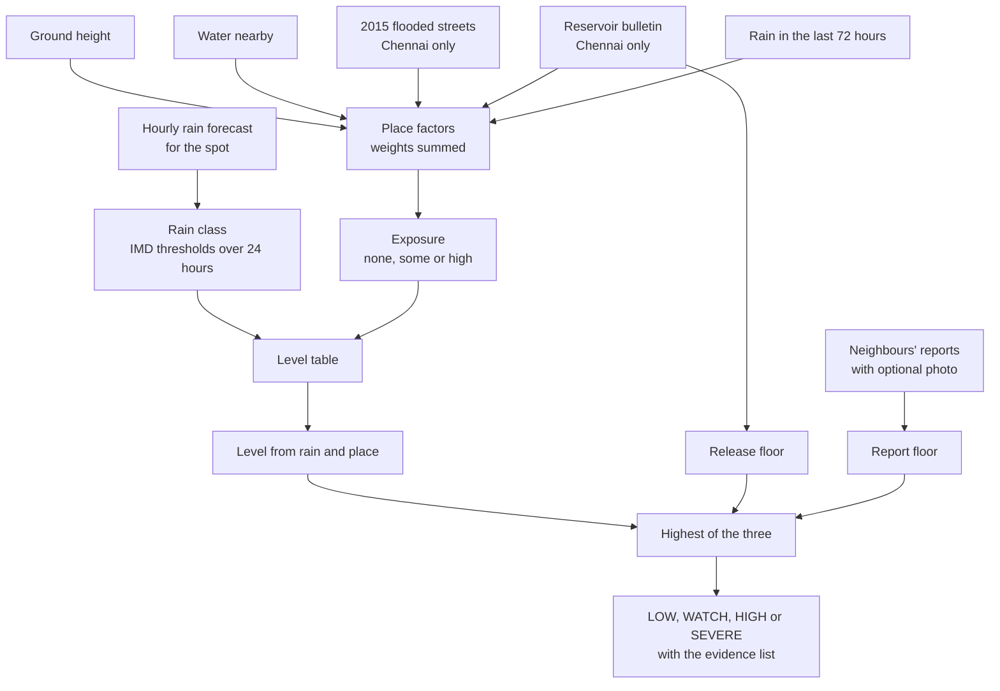
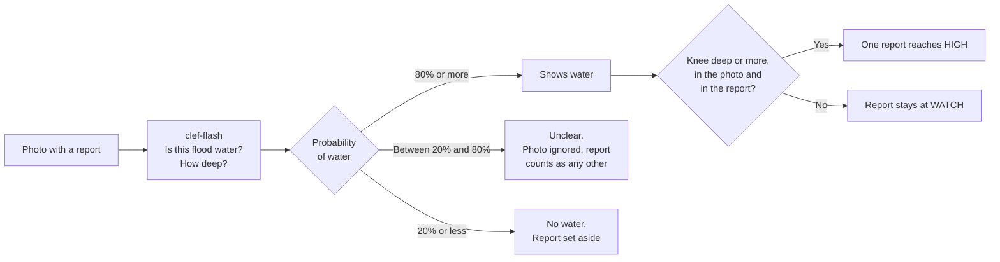
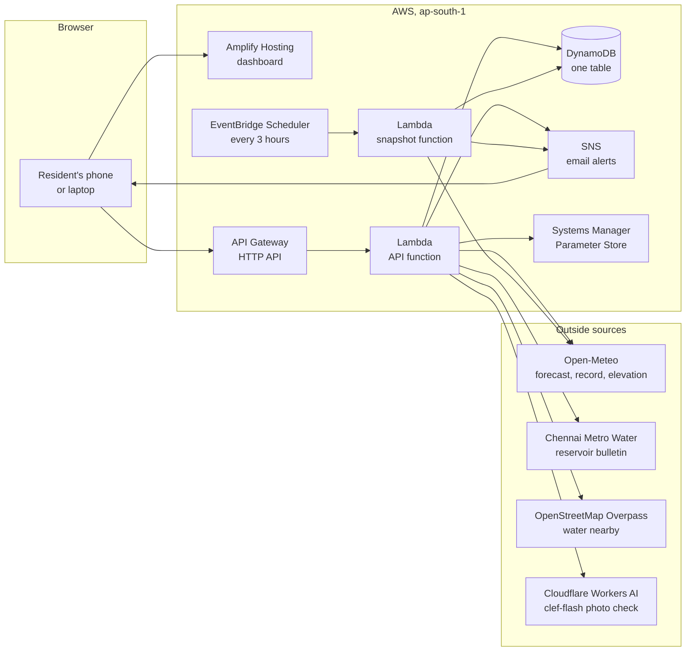
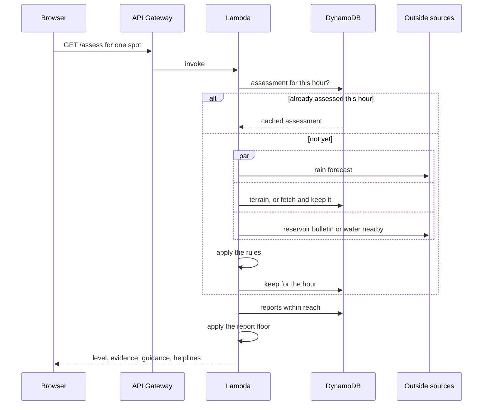
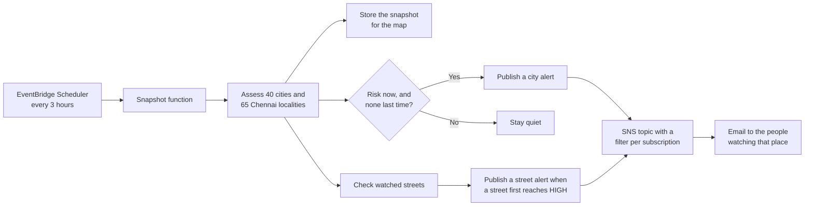

# Vellam

**Will my street flood in the next 48 hours, why, and what should I do about it?**

Vellam (the Tamil word for flood) answers that question for any place in India. It gives one
of four levels for a single street, lists every fact behind the level, tells the resident
what to do, and then checks its own forecast against the rain that fell.

| | |
|---|---|
| **Live** | https://vellam.d3tsllqujf4lwr.amplifyapp.com |
| **Event** | [Environmental Hacks](https://www.wemakedevs.org/aws/env), event two of the WeMakeDevs x AWS Bharat Builds Tour, 8 to 11 October 2026 |
| **Track and path** | Heat and Water. Ship It, deployed on AWS |
| **Team** | DoodleByte |

## Contents

1. [The problem](#1-the-problem)
2. [What Vellam does](#2-what-vellam-does)
3. [How it decides](#3-how-it-decides)
4. [What we measured](#4-what-we-measured)
5. [Where not to trust it](#5-where-not-to-trust-it)
6. [Architecture](#6-architecture)
7. [Repository](#7-repository)
8. [Run it locally](#8-run-it-locally)
9. [Deploy it](#9-deploy-it)
10. [Data and licences](#10-data-and-licences)
11. [Team and tools](#11-team-and-tools)

## 1. The problem

Flood warnings in India are issued for a district. Floods happen street by street.

In December 2015 and again in December 2023, large parts of Chennai went under water, and
many of the same neighbourhoods were hit both times. A resident who reads "heavy rain likely
over Chennai district" still does not know what they need to know: will my street flood,
when, and should I move the bike tonight?

The same gap between a district warning and a street exists in every Indian city that
floods. Vellam began with Chennai, where the northeast monsoon starts in October, and now
answers for the whole country.

## 2. What Vellam does

| A resident asks | Vellam answers with |
|---|---|
| Will my street flood? | One of four levels (LOW, WATCH, HIGH, SEVERE) for each six hours of the next 48. Search any city, town or village in India, use the phone's location, or tap a spot on the map |
| Why? | Every fact behind the level, each labelled by its source: forecast, measurement, terrain, map, the 2015 record, reservoir bulletin, a neighbour's report, or Vellam's own judgement |
| What should I do? | Steps for that level, helplines as tap-to-call buttons, and one tap to send the warning to a street WhatsApp group |
| What does my street look like? | The street in 3D with real ground heights and buildings, and a slider that floods everything below a chosen height. A flat map is one tap away |
| Where do I move the car? | Up to three roads within 1.2 km that are at least 2 m higher and clear of streets that flooded in 2015, with directions |
| Is it flooding near me now? | Reports from neighbours: none, ankle, knee or waist deep, with an optional photo. Reports stay for 48 hours, store nothing about the person, and can raise the level |
| Is the reservoir releasing? | In Chennai, the day's Metro Water bulletin: how full each reservoir is and how much it is letting go |
| Can I trust it? | For any spot, the last 30 days of day-ahead rain forecasts beside the rain that fell |
| What would it have said then? | A replay of five Chennai storms, December 2015 to November 2024, through the same rules, with the 48 hours playable as a time-lapse |
| Will you tell me? | Forty major cities and 65 Chennai localities are reassessed every three hours. An email goes out when risk appears, and a resident can ask for one about their own street |

### Two depths of answer

| | Chennai | Rest of India |
|---|---|---|
| Rain forecast and soaked ground | Yes | Yes |
| Ground height and surroundings | Yes | Yes |
| Water nearby | Bundled map of 1,704 water bodies | Read from OpenStreetMap, within 1 km, when the place is first asked about |
| Streets that flooded in 2015 | 7,851 streets | No record |
| Reservoir storage and releases | Daily bulletin | No data |
| Neighbours' reports and photo check | Yes | Yes |

Every answer says which of the two it is.

### Languages

The pages a resident uses are offered in English, Hindi, Bengali, Telugu, Marathi, Tamil,
Urdu, Gujarati, Kannada, Malayalam, Odia, Punjabi and Assamese. English ships with the page
and the others load when chosen. The translations were made by machine and have not been
reviewed by native speakers. The reasons behind an answer, the landing page and the How it
works page are in English.

## 3. How it decides

Rules set every level. The same street, forecast and reports always give the same answer,
and the answer lists every fact it used.



### Step 1. How much rain

The hourly forecast for the spot is summed over every 24 hours of the next two days and named
with the India Meteorological Department's classes.

| Class | Rain in 24 hours |
|---|---|
| Light or none | Under 15.6 mm |
| Moderate | From 15.6 mm |
| Heavy | From 64.5 mm |
| Very heavy | From 115.6 mm |
| Extremely heavy | From 204.5 mm |

### Step 2. What kind of place

| Factor | Counts when | Weight | Source |
|---|---|---|---|
| This street flooded in 2015 | A street residents marked as flooded is within 60 m | 2 | [osm-in/flood-map](https://github.com/osm-in/flood-map) |
| Streets nearby flooded in 2015 | One is within 200 m | 1 | Same |
| Reservoir upstream is releasing | The street is within 500 m of the Adyar or the Kosasthalaiyar and the release is 3,000 cusecs or more | 2 | [Chennai Metro Water](https://cmwssb.tn.gov.in/lake-level) |
| Reservoir upstream is nearly full | Same street, and the reservoir is at least 80% full | 1 | Same |
| Close to a water body | A lake, marsh, river or canal within 300 m. Within 100 m counts double | 1 or 2 | OpenStreetMap |
| Low ground | Five metres above sea level or less | 1 | Copernicus elevation model |
| Lower than its surroundings | At least five metres below the ground a kilometre around | 1 | Same |
| Ground already soaked | More than 115.6 mm of rain in the previous 72 hours | 1 | Rain record |
| On raised ground | At least ten metres above its surroundings | -1 | Copernicus elevation model |

A total of 0 or less is no exposure, 1 is some, 2 or more is high.

### Step 3. The level table

| Rain in 24 hours | No exposure | Some | High |
|---|---|---|---|
| Light or none | LOW | LOW | LOW |
| Moderate | LOW | LOW | WATCH |
| Heavy | WATCH | WATCH | HIGH |
| Very heavy | WATCH | HIGH | SEVERE |
| Extremely heavy | HIGH | SEVERE | SEVERE |

Rain alone can raise the level. The place alone cannot: a low street under a dry sky is not
at risk today.

### Step 4. Two floors under the table

Two things raise a level whatever the rain at that spot, because both are water that is
already there.

| Floor | Rule |
|---|---|
| Reservoir release | A street within 500 m of the river is at least HIGH for a release of 3,000 cusecs or more, and at least SEVERE for 10,000 or more |
| Neighbours' reports | Within 300 m and six hours. One report raises a street to WATCH and no further. Two that agree on knee deep or more raise it to HIGH. Two on waist deep raise it to SEVERE. A report of no water never lowers a level |

### The one place a model is used

A resident can attach a photo to a report. The photo goes to
[clef-flash](https://developers.cloudflare.com/workers-ai/models/clef-flash/), a decision
model hosted on Cloudflare Workers AI, with two typed questions: does this show flood water,
and how deep. It returns a probability for each allowed answer, not prose, so its output is
held to thresholds like any other measurement.



- A photo never takes a street to SEVERE alone. It proves water somewhere, not that it was
  taken on that street today.
- The photo is read once and not stored. Only the verdict is kept with the report.
- When the model cannot be reached, the report is saved without a verdict.

## 4. What we measured

### Thresholds that were wrong first

The thresholds are judgements. Five of them were wrong on the first attempt, and the data or
the live system said so.

| First attempt | What showed it was wrong | Now |
|---|---|---|
| Flooded street within 150 m, nearby within 400 m | 150 m reached 52% of random points in the core city and 400 m reached 79%, so the factor said yes to almost everyone | 60 m and 200 m, which reach 25% and 62% |
| Height differences of 2 m and 3 m | The elevation model is a 90 m grid that includes rooftops. It described Velachery, one of the most flooded parts of Chennai, as raised ground | 5 m and 10 m |
| Ground soaked after 64.5 mm in 72 hours | Replaying 15 October 2024, every locality counted as soaked after one wet day and 47 of 65 came out HIGH | 115.6 mm |
| A reservoir release counted only as a factor of the place | Replaying December 2015, Saidapet beside the Adyar came out as WATCH on the day 29,000 cusecs were released | A release sets its own floor |
| Reports searched by stepping the coordinate | On the live site one report was read back as two, which let a single report reach HIGH | Search cells are stepped by whole numbers |

### Replays

| Storm | Result | What it shows |
|---|---|---|
| Cyclone Michaung, 4 December 2023 ([full table](docs/backtest-2023-12-04.md)) | 65 localities: 51 SEVERE, 11 HIGH, 3 WATCH. Of 17 named as flooded by Sphere India or the press, Vellam rated 16 HIGH or SEVERE. It missed Perungudi | Weak evidence on its own. Vellam flagged 62 of 65 localities, so a rule that warned everyone would have caught the documented ones too |
| Heavy rain, 15 October 2024 ([full table](docs/backtest-2024-10-15.md)) | 0 SEVERE, 33 HIGH, 27 WATCH, 5 LOW | The levels spread out under ordinary heavy rain. No list of flooded localities was collected for this date, so it does not show that they were right |
| The flood of 1 December 2015 | 4 of 65 localities HIGH or SEVERE, all beside the Adyar | A failure of the rain record. It shows 49 mm on the day the Chembarambakkam gauge measured 475 mm, so the replay is nearly dry. The four are held up by the 29,000 cusec release alone |

Perungudi was missed because no street within 200 m of the locality's centre point was marked
in 2015 and no water body is mapped within 300 m of it. It was still under water five days
after the cyclone.

### Forecast record

For any spot, the dashboard shows how the day-ahead forecast compared with the rain that fell
on each of the last 30 days. The build week was dry, so no heavy rain day falls in that
window yet. The page says so and does not report a score that has not been tested on the
days that matter.

### What has not been measured

- The photo check. We have no set of labelled flood photos, so its thresholds are untested
  judgements. On the live system it has been run on one synthetic picture, which it
  correctly judged to show no water.
- Any place outside Chennai. No replay or documented flood list has been compared for
  another city.

## 5. Where not to trust it

| Limit | Consequence |
|---|---|
| The level is a rule of thumb | Vellam does not model how water moves through drains and streets |
| The 2015 map was drawn by volunteers during the flood | A street missing from it may still have flooded, and nothing since 2015, including new storm drains, is reflected |
| Forecasts and rain records can be wrong | Cloudbursts are not predicted, and the historical record can be far too low, as December 2015 shows |
| The reservoir bulletin is published once a day | A release ordered at night is not seen until the next morning |
| Outside Chennai there is no flood history and no reservoir data | The answer rests on rain, ground height and nearby water alone |
| The lookup of nearby water uses a public OpenStreetMap server | When it does not answer in five seconds the page says water was not assessed, and the next visit asks again |
| Reports are anonymous and unverified | One report alone raises a street only to WATCH |
| A photo cannot prove where or when it was taken | An old photo of a real flood would pass the check, so a photo is worth one extra report and no more |
| The 3D water slider shows the shape of the ground | It floods everything below one height and is not a forecast. The height data is a satellite survey that includes rooftops |
| Higher-ground suggestions rest on the same height data | A flyover or a rooftop can be mistaken for a road. Look at the place before relying on it |
| A locality or city on the map is assessed at one point | The place page for an exact spot is the answer to read |
| Translations are machine-made | Wording may be awkward or wrong in any language other than English |

Vellam is not an official warning. Follow the India Meteorological Department and your local
authority.

## 6. Architecture

### System



### One assessment



Reports are applied after the hourly cache, so a report shows in the answer the moment it is
sent.

### Snapshot and alerts



### AWS services

| Service | What it does here |
|---|---|
| Lambda (Node.js 22, arm64) | Two functions: the API, and the job that assesses every watched place |
| API Gateway HTTP API | The public API, throttled to 2 requests a second with a burst of 10, since it has no sign-in |
| DynamoDB | One on-demand table. Terrain and nearby water are kept for good, assessments for the hour, reports for 48 hours. Time-to-live removes expired items, so nothing needs a cleanup job |
| EventBridge Scheduler | Rebuilds the snapshot every three hours |
| SNS | Email alerts. A message goes out when risk appears, not every three hours while it lasts. A filter on each subscription sends a street's alert only to the people watching that street |
| Systems Manager Parameter Store | Holds the Cloudflare account ID and token for the photo check. The token is a SecureString created by hand, so it is in no template and no code |
| Amplify Hosting | Serves the dashboard over HTTPS |
| CloudFormation, through SAM | The whole stack is one template, `infrastructure/template.yaml` |
| CloudWatch Logs | Function logs. Upstream errors are logged in full and shown to the visitor as a plain message |
| IAM | The API function can read and write its table, subscribe to the topic and read the two parameters. Only the snapshot function can publish |

### Design choices

| Choice | Reason |
|---|---|
| No queue or stream | The work is one request at a time and one scheduled job every three hours. The real ceiling is the free weather source's per-minute quota, not our own throughput |
| Rules, not a trained model, set the level | Every level can be traced to a number shown on the page, and a wrong LOW is the one failure the product cannot afford |
| The photo check runs outside AWS | Running the model ourselves needs a GPU, and this account's GPU quota is zero. It is the only call that leaves AWS apart from the open data sources |
| The core does no input or output | `engine/src/core` receives plain values and returns plain values, so the rules are tested without a network or an AWS account |
| Pay per request throughout | At this project's traffic every service sits inside its free tier |

## 7. Repository

```
engine/src/core      the rules: rain classes, place factors, reservoirs, reports, the level table, forecast checks
engine/src/sources   Open-Meteo, the reservoir bulletin, the OpenStreetMap water lookup, the photo check
engine/src/api       the service, router, DynamoDB storage and the two Lambda handlers
engine/src/data      Chennai water bodies, localities and 2015 flooded streets; India's major cities
engine/scripts       local API server, Lambda build, and the backtest
scripts              the scripts that produced the data files
web                  the dashboard: React, Vite, Leaflet for the flat map, MapLibre for the 3D street
web/src/locales      the interface text, one file per language
web/src/vendor       animated components copied from React Bits, with their licence
infrastructure       SAM template and the dashboard deploy script
tests                94 tests, run without a network or an AWS account
docs                 backtest results
```

## 8. Run it locally

Requires Node.js 22.18 or later. No AWS account or API key is needed.

```bash
npm install
npm test            # 94 tests
npm run dev:api     # API on http://localhost:8787, in-memory storage, real weather
npm run dev:web     # dashboard on http://localhost:5183
```

The local API runs without the photo check, so a report with a photo is saved with no
verdict.

```bash
npm run backtest                  # replay Cyclone Michaung across all localities
npm run backtest -- 2024-10-15    # or any other date
```

## 9. Deploy it

Requires the AWS CLI and the SAM CLI.

```bash
npm run deploy:platform   # API, functions, table, schedule, topic
npm run deploy:web        # build the dashboard against the API and publish it
```

**Amplify.** New AWS accounts are limited to very few Amplify apps. To publish as a branch of
an app you already have, set `ExistingAmplifyAppId` and `DashboardBranchName` in
`infrastructure/samconfig.toml`.

**Photo check (optional).** Store a Cloudflare account ID and a Workers AI API token. Without
them, reports are saved with no verdict.

```bash
aws ssm put-parameter --name /vellam/cloudflare-account-id --type String --value <account id>
aws ssm put-parameter --name /vellam/cloudflare-token --type SecureString --value <token>
```

**Replays.** To store the replay of a past storm for the map:

```bash
aws lambda invoke --function-name <SnapshotFunctionName> --payload '{"date":"2023-12-04"}' --cli-binary-format raw-in-base64-out out.json
```

## 10. Data and licences

| Data | Source | Licence |
|---|---|---|
| Rain forecast, earlier forecasts, rain record, elevation | [Open-Meteo](https://open-meteo.com) | CC BY 4.0 |
| Place search | [Open-Meteo geocoding](https://open-meteo.com/en/docs/geocoding-api), from GeoNames | CC BY 4.0 |
| Streets flooded in December 2015 | [osm-in/flood-map](https://github.com/osm-in/flood-map), crowd-sourced during the flood | MIT |
| Water bodies, locality names, water near places outside Chennai | [OpenStreetMap](https://www.openstreetmap.org/copyright) contributors, the last through the Overpass API | ODbL |
| Reservoir storage and releases | [Chennai Metropolitan Water Supply and Sewerage Board](https://cmwssb.tn.gov.in/lake-level) daily bulletin | Public bulletin |
| Ground heights in the 3D view | [Terrain Tiles](https://registry.opendata.aws/terrain-tiles/) on the Registry of Open Data on AWS | See registry |
| 3D base map and buildings | [OpenFreeMap](https://openfreemap.org), from OpenStreetMap | ODbL |
| Flat map tiles | OpenStreetMap contributors | ODbL |
| Rain classes | [India Meteorological Department](https://rsmcnewdelhi.imd.gov.in/uploads/archive/8/8_f9822f_heavy%20rainfall%201506.pdf) bulletins | Public document |
| What to do | Based on the [National Disaster Management Authority](https://ndma.gov.in/Natural-Hazards/Floods/Dos-Donts)'s flood guidance | Public guidance |
| Helplines | 112 and 1078 are national numbers. 1070 and 1913 are from the [Tamil Nadu State Disaster Management Authority](https://www.tnsdma.tn.gov.in/app/webroot/img/2022/DisasterTelephoneBook_2023.pdf) directory | Public directory |
| Photo check | [clef-flash](https://developers.cloudflare.com/workers-ai/models/clef-flash/) on Cloudflare Workers AI | Hosted service |
| Illustrations | [unDraw](https://undraw.co), recoloured | unDraw licence |
| Typefaces | Plus Jakarta Sans and JetBrains Mono | SIL Open Font Licence |
| Icons | [Phosphor](https://phosphoricons.com) | MIT |
| Hero waves, magnetic button, click sparks, counting numbers | [React Bits](https://reactbits.dev), copied into `web/src/vendor/react-bits` | MIT + Commons Clause |

The code is under the [MIT licence](LICENSE).

## 11. Team and tools

Built by team **DoodleByte** during the event.

| Member | Role |
|---|---|
| Gowtham K | Team lead |
| Jaya Suriya T R | Member |
| Pranav A S | Member |
| Kannan K | Member |

**AI tools used.** Claude Code (Anthropic) was used as an AI pair programmer for the code,
tests, infrastructure template, documentation and the machine translation of the interface.
clef-flash (Cloudflare Workers AI) is part of the product: it judges the photo sent with a
report, as section 3 describes. Vellam's levels come from fixed rules.

**Reused from our earlier projects.** The deploy script for the dashboard, and the cloud
mascot's character, which is redrawn here as an SVG in red.
